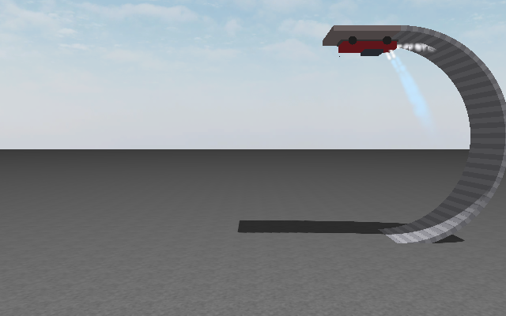
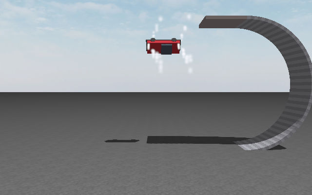
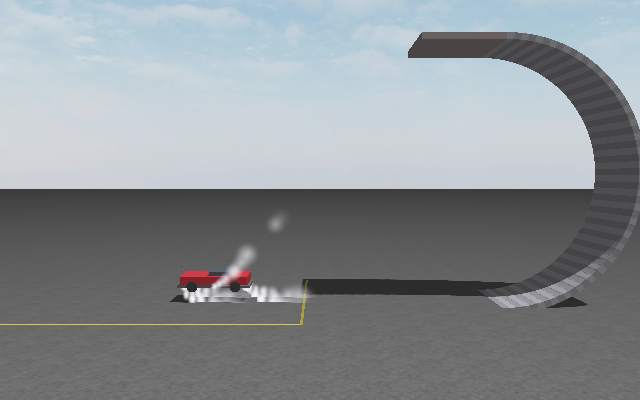
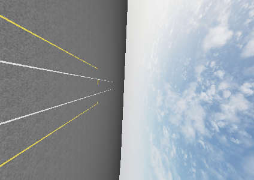

# Roadster stunt simulation

A ROS 2 (Humble) + Gazebo (Ignition Fortress) simulation of the inverted-ramp stunt from Tesla's 2026-10-15 Roadster unveil.
The car drives up a curved ramp past vertical, held on by suction fans, stops upside down at the top and holds there, then drives off the overhang still upside down, kick-flips 180 degrees in the air on cold-gas thrusters, brakes its fall with them, and lands on its wheels.

It is a plausible engineering reproduction built on public reporting, not a replica of Tesla's hardware or controller: the nozzle layout, fan force, mass and ramp size are assumptions (see `docs/plans/roadster_demo_plan.md` for sources, confidence and the full plan).
The car model was derived from the sedan in [kfan12/vlm_av_ws](https://github.com/kfan12/vlm_av_ws), where this work started as a branch; that repository's history is kept here, but the autonomous-driving stack itself now lives only there.

https://github.com/user-attachments/assets/da463c21-0af6-4663-8d04-b17aed2fd3d3

| Drive-off, upside down (trackside camera) | Kick flip in flight | Landing burn | Mid-flip (onboard camera) |
| --- | --- | --- | --- |
|  |  |  |  |

## Sequence (Demo A: the inverted ramp)

1. **Run-in:** accelerate to 6 m/s; the suction fans spin up about 6 m before the ramp.
2. **Climb:** round an 8 m radius loop at 6 m/s, pressed onto the track by the fans.
3. **Stop and hold:** brake on the upper arc and stop just past the top, upside down on a 5 m overhang, and stand still for 1 s on fan suction alone (parking brake on the wheels).
4. **Drive-off:** from standstill, still upside down, accelerate forward with the wheels plus the four rear thrusters and let go of the overhang at about 7 m/s.
5. **Kick flip:** roll 180 degrees about the car's long axis in about 0.8 s while flying forward.
6. **Landing burn:** fire the bottom thrusters at 1.5 g, then flare harder (2 g) over the last metre to touch down gently at about 0.6 m/s, then roll out and stop.

## Hardware enablers (as modelled)

- **Cold-gas thrusters:** 10 nozzles fed from a 600 L carbon-overwrapped tank at 400 bar (about 250 kg of air), regulated to 100 bar at the nozzles, with first-order valve lag (20 ms) and a minimum on-time.
  Four rear nozzles facing backward (4 x 1.125 m g, the launch), four bottom corner nozzles pushing up (4 x 1.1 m g, lift, landing and the flip's roll torque) and two side nozzles, one exhausting to each side (2 x 0.5 m g, at the centre of mass so they push sideways without any torque).
  With no nozzle pushing toward the floor there is no force-free roll couple: the kick flip rolls on one side's bottom pair, whose push sweeps through the horizontal as the car turns and would carry it about 5 m sideways, landing with 4 m/s of sideways speed.
  The side nozzles cancel that drift, during the flip and in the descent after it: the car touches down about 0.4 m off the centreline with under 0.1 m/s of sideways speed, inside a 12 m wide landing zone.
  The tank depletes with use, so gas is the binding budget: the demo uses about 170 of the 250 kg.
- **Suction fans:** up to 1.5 m g of downforce along the body's floor normal, with spin-up lag, an immediate cut-off (at release the car is in a 1 g fall at once) and a ground-effect falloff with the gap to the track (computed from the track's analytic geometry), enough to hold the car upside down at standstill.
  This is a lumped force; the physical mechanism (a pressure drop under a skirted floor, set by the fan curve and the skirt leakage) is not modelled yet.
- **Suspension:** a preloaded spring-damper per corner (250 kN/m, damping ratio 0.5, plus or minus 12 cm), sized for the 4-5 g load at the bottom of the loop.
  Without it the rigid car can rest on one diagonal, leaving only two driven wheels.
- **Sensors:** a 1 kHz IMU (sampled every physics step, so the rigid-wheel contact impulses on the ramp are integrated instead of aliased), wheel encoders, force/torque sensors on the four wheel joints (wheel load and contact), and a trackside plus an optional onboard camera.
- **Drive:** torque-controlled wheels on all four corners and position-controlled front steering, through `ros2_control`.

All stunt forces (tank, nozzles, fan, suspension springs) come from a single Gazebo system plugin (`roadster_gz_plugins`), so there is exactly one writer of the car's external forces.

## Control method

- **Mission state machine** (`roadster_control/stunt_mission_node`): run-in, climb, stop, inverted hold, drive-off, release, flip, descent, landing brake, landed, rollout, stopped, with an abort path.
- **Ground phase:** a speed PI with gravity feed-forward along the track and per-wheel traction control (wheel torque capped at k mu N r from the measured wheel load).
  Progress is measured as distance along the whole track (run-in, arc, overhang), the stop onto the hold point is a planned constant-deceleration trajectory, and while standing the wheels are held by a parking brake.
  Steering is held straight: the track is straight in one vertical plane, so with no disturbance there is nothing to correct.
- **Flight phase:** a quaternion attitude controller (PD on the rotation-vector error with reference rate and acceleration feed-forward and gyroscopic compensation) tracks a minimum-jerk 180 degree roll.
  A thrust allocator solves a small QP with OSQP for the 10 valve openings (bounded to [0, 1], since a nozzle can only push), weighting forces in world axes (lift up, braking any sideways velocity whatever the attitude) and torques in body axes.
- **Landing:** a two-stage constant-deceleration velocity profile (1.5 g, then a 2 g flare below 1 m) latches on once the car falls faster than it, with the deceleration feed-forward only while descending.
  The flare has stiffer feedback, starts 40 ms early to cover the nozzles' thrust rise, and ends early by their thrust fall, so the car arrives at about 0.6 m/s without hovering.
  Touchdown is detected from wheel contact, with a height backup only below the standing height.
- **State estimation** (`roadster_control/state_estimator_node`): an IMU strapdown integration in a 15-state error-state EKF (position, velocity, attitude, accelerometer and gyro biases).
  It is corrected only by what the car can sense itself: wheel speed (encoders plus gyro pitch rate) with no side-slip and no hop, each loaded wheel centre one radius from the known track surface, and zero-velocity, gravity and zero-rate updates when standing still.
  In flight it runs on the IMU alone.
  Wheel-velocity updates are innovation-gated with fault recovery.
  Over a whole run the estimate stays within about 5 cm and 0.3 degrees of Gazebo's ground truth, and the mission flies on it by default.

## Requirements

- ROS 2 Humble and Ignition Gazebo Fortress, with `ros_gz` (bridge, sim, interfaces), `gz_ros2_control` (`ign_ros2_control`), `ros2_control` with the effort and position controllers, `xacro`, `robot_state_publisher` and `rviz2`.
- OSQP and osqp-eigen built from source into `/usr/local` (`roadster_control/CMakeLists.txt` points `OsqpEigen_DIR` there).
- Eigen3, yaml-cpp, nlohmann-json.
- On WSL2, Gazebo runs with `LIBGL_ALWAYS_SOFTWARE=1` (the sim launch sets it); Python nodes that import `cv2` need `PYTHONNOUSERSITE=1`.

## Run it

```bash
cd ~/roadster_ws
colcon build --symlink-install
source install/setup.bash

# Gazebo + RViz + the mission; the world starts paused and unpauses after ~14 s
ros2 launch roadster_control demo_a.launch.py

ros2 launch roadster_control demo_a.launch.py state:=truth          # fly on Gazebo ground truth instead of the IMU estimate
ros2 launch roadster_control demo_a.launch.py gui:=false            # RViz only, no Gazebo window
ros2 launch roadster_control demo_a.launch.py onboard_camera:=false # skip the car's camera (saves render time)
ros2 launch roadster_control demo_a.launch.py release_after_hold:=false   # climb and stay upside down
```

To launch the pieces by hand (for example to restart only the mission):

```bash
# 1. the simulation: Gazebo world + roadster + bridges + ros2_control (paused until unpaused)
ros2 launch roadster_description roadster_sim.launch.py world:=roadster_ramp paused:=true gui:=true
# 2. the IMU state estimator + the stunt mission
ros2 launch roadster_control stunt_mission.launch.py mode:=ramp world:=roadster_ramp state:=imu
# 3. unpause the world
ign service -s /world/roadster_ramp/control --reqtype ignition.msgs.WorldControl \
    --reptype ignition.msgs.Boolean --timeout 3000 --req 'pause: false'
```

A recorded and scored run (writes `data/stunt_runs/<session>/run.jsonl` and `metrics.json`, prints PASS or FAIL per check):

```bash
scripts/run_stunt_scenario.sh roadster_ramp ramp                              # mission on ground truth
MISSION_ARGS="state:=imu" scripts/run_stunt_scenario.sh roadster_ramp ramp    # mission on the IMU estimate
```

The snapshots above come from such a run with the onboard camera on, saved by a capture tool started next to it:

```bash
MISSION_ARGS="state:=imu" scripts/run_stunt_scenario.sh roadster_ramp ramp snapshots -- with_camera:=true &
python3 tools/avkit/capture_stunt_snapshots.py --out docs/snapshots
```

The stunt worlds are generated into `src/roadster_description/worlds/`, with their geometry in `src/roadster_description/maps/<world>.json` (the single source the fan, estimator and mission read).
Rebuild after generating, so the new files are installed:

```bash
python3 scripts/generate_stunt_world.py --kind ramp --radius 8              # roadster_ramp (5 m overhang)
python3 scripts/generate_stunt_world.py --kind ceiling --height 16 --out roadster_drop16
colcon build --symlink-install --packages-select roadster_description
```

Unit tests (actuation models, attitude and landing control, allocator, error-state EKF):

```bash
colcon test && colcon test-result --verbose
```

In RViz the car carries orange thrust arrows (one per nozzle, length proportional to thrust), white exhaust puffs and blue fan exhaust trailing in the air, a fan disc that glows with fan speed, IMU arrows (specific force, angular rate), control arrows (requested and allocated thrust, requested torque, per-wheel drive and brake torque), the true and estimated paths, mission, control and IMU panels, and the trackside and onboard camera views.
Gazebo shows the same thrust and fan plumes as particle effects.

## Result

IMU-flown run (`state:=imu`): stands upside down at the top for 1.0 s without moving, all four wheels loaded from run-in to drive-off, release at 7.2 m/s, 180 degree flip, touchdown at 0.57 m/s vertical with 0.2 degrees tilt and a peak of 2.0 g, 0.43 m off the centreline at 0.1 m/s sideways, then a rollout to a stop, with no body contact; the whole stunt takes 18 s of sim time.
It uses 188 kg of the 250 kg of air.
The tank leaves regulation (below 100 bar at the nozzles, so every nozzle weakens) at about 68 kg, so the usable budget is about 182 kg: the end of the landing burn already runs at 92% feed pressure, and gas is the binding limit.
The simulation is deterministic apart from sensor noise, so repeated runs show repeatability, not margin; robustness testing (noise, wind, parameter sweeps) is still to come.

## Packages

| Package | Role |
| --- | --- |
| `roadster_description` | Roadster URDF (torque-driven wheels, suspension, nozzle frames, IMU, wheel force/torque sensors, particle effects), sim launch, bridge, stunt worlds and their geometry maps. |
| `roadster_gz_plugins` | The actuation system: compressed-air tank, 10 cold-gas nozzles, suction fan, suspension springs and effect switching, plus unit-tested models. |
| `roadster_control` | Stunt mission node, IMU state estimator, OSQP thrust allocator, attitude and landing control, RViz visualization, demo launch. |
| `roadster_msgs` | `StuntStatus`, the mission's per-tick state, control and allocation record (`/stunt/status`). |

Tooling outside the packages: `scripts/` (world and texture generators, the scored-run script) and `tools/avkit/` (run recorder and analyzer, actuation, hold and smoke tests).
