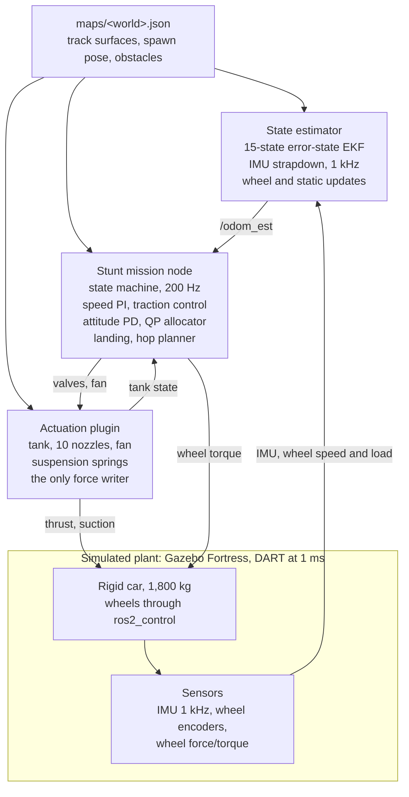

# Roadster Stunt Sim: Control and Modelling Report

2026-10-18.
Markdown copy of the [shared report](https://claude.ai/code/artifact/027ad024-a01f-49e8-a372-5c0fdac8ca90); figures are from the scored runs of 2026-10-18.

## Summary

The simulation reproduces all three stunts from Tesla's 2026-10-15 Roadster unveil, flown on the car's own IMU estimate, and every scored check passes.
It is a plausible engineering reproduction in ROS 2 Humble and Ignition Gazebo Fortress, not a replica: nozzle layout, fan force, mass and ramp size are assumptions, since Tesla published none of them.

| | Demo A, inverted ramp | Demo B, obstacle hop | Demo C, straight launch |
| --- | --- | --- | --- |
| Stunt | Hold inverted 1.0 s, release at 7.27 m/s, 180 deg roll | 360 deg roll, 1.13 m over the 4.1 m Semi | 0-60 mph in 0.810 s over 10.7 m |
| Touchdown | 0.56 m/s, 1.88 g peak | 0.56 m/s, 1.88 g peak | - |
| Gas used (of ~182 kg usable) | 195 kg | 175 kg | 109 kg |

The two gaps this report draws out:

- **Gap to the real stunt:** the vehicle, actuators and stunt geometry are sized from early press figures and owner-described layouts, not measured, and the video calibration (Phase 8) has not been done.
  The flip, landing and hold are therefore plausible, not matched.
- **Gap to real deployment:** the controller has only ever flown a deterministic, noise-light model with idealised actuators, perfect timing and no faults.
  It has no safety monitor, no Monte Carlo robustness evidence, and no hardware-in-the-loop or real-time execution story.

Gas is the binding limit in the model today: Demo A exceeds the usable budget and finishes its landing burn at 82% feed pressure.

## System overview

The workspace is four ROS 2 packages built around two invariants: one Gazebo plugin writes every external force on the car, and one generated map file owns all world geometry.

| Package | Role |
| --- | --- |
| `roadster_description` | URDF (torque-driven wheels, suspension, nozzle frames, IMU, wheel force/torque sensors, particle effects), worlds, bridge, sim launch |
| `roadster_gz_plugins` | The actuation system: tank, 10 nozzles, suction fan, suspension springs, with unit-tested models |
| `roadster_control` | Mission node, IMU state estimator, OSQP allocator, attitude and landing control, hop planner, RViz visualisation |
| `roadster_msgs` | `StuntStatus`, the mission's per-tick state, control and allocation record |



The mission flies on `/odom_est` by default; Gazebo's `/odom_truth` is used only for scoring, or for flying on truth (`state:=truth`).
Language policy: everything in the control loop is C++; Python is only world generation, visualisation and offline analysis.

## Vehicle and actuator modelling

The plant is a 1,800 kg rigid car on DART at a 1 ms step, with every stunt force applied by one Gazebo system plugin from small, unit-tested models.
The models are deliberately first-order: they capture the budgets and lags that shape the control problem, not the fluid or tyre physics behind them.

### Rigid body and drivetrain

- **Body:** a 1,690 kg chassis box plus wheels, steering knuckles and suspension carriers (1,800 kg total), wheelbase 2.7 m, track 1.6 m, wheel radius 0.33 m.
  Inertias come from box and cylinder primitives, not a measured mass distribution.
- **Wheels:** four torque-controlled joints (2,500 N.m, 200 rad/s limits) through `gz_ros2_control`; front steering is position-controlled (3,000 N.m).
- **Tyres:** DART rigid contact with Coulomb friction, mu = 1.2 in both directions.
  There is no slip-dependent tyre model (no Pacejka curve, relaxation length or load sensitivity).
- **Suspension:** a preloaded spring-damper per corner, 250 kN/m, damping ratio 0.5, plus or minus 12 cm, applied by the plugin through `JointForceCmd` because SDF joint springs under DART did not deflect in proportion to 1/k.

### Cold-gas propulsion

- **Tank:** 0.6 m^3 at 400 bar and 293 K (about 250 kg of air), isothermal, with a real-gas correction Z = 1 + kP (Z = 1.14 at 400 bar).
  Regulated feed at 100 bar until the tank falls below it, blowdown after, nothing below 25 bar.
- **Nozzles (10):** four rear (4 x 1.125 m g), four bottom corners pushing up (4 x 1.1 m g), two side nozzles at the centre of mass (2 x 0.5 m g).
  The grouping is as the project owner described it; positions and sizes are assumptions.
- **Valve and thrust:** command u in [0, 1], first-order lag (20 ms rise and fall), 20 ms minimum on-time enforced in the plant so the controller cannot chatter it.

```math
F_i = u_{i,\mathrm{actual}} \, f_{\max,i} \, \frac{P_{\mathrm{feed}}}{P_{\mathrm{ref}}}, \qquad \dot m_i = \frac{F_i}{v_e}, \quad v_e = 350\ \mathrm{m/s}
```

- **Verified:** a zero-g test fires every nozzle alone and in three combinations; measured force matches the rigid-body prediction within 0.3% and torque within 0.1% on all 13 patterns.

### Suction fan

- A lumped force along body -z at the floor centre, up to 1.5 m g (26.5 kN), with a 0.3 s spin-up lag and an immediate cut-off.

```math
F_{\mathrm{fan}} = F_{\max} \, w^2 \, g(h), \qquad g(h) = \begin{cases} 1 & h \le 0.35\ \mathrm{m} \\ \dfrac{1.0 - h}{0.65} & 0.35 < h < 1.0 \\ 0 & h \ge 1.0 \end{cases}
```

- The gap h is computed from the world's analytic surfaces (planes and concave arcs in `maps/<world>.json`), since Fortress gives systems no ray queries.
- The physical mechanism (pressure under a skirted floor, set by the fan curve and skirt leakage) is not modelled.

### Sensors

- **IMU at 1 kHz,** Gaussian noise plus bias random walk (gyro 0.009 rad/s, accelerometer 0.08 m/s^2 white noise).
  The rate is set to the physics step on purpose: at 200 Hz it aliased the rigid-wheel contact impulses and broke the estimator.
- **Wheel encoders and force/torque sensors** on the four wheel joints give wheel speed, load and contact.
- **Trackside and onboard cameras** exist for video only; no control loop uses vision.

### Worlds

Ramp, hop, launch, ceiling and drop worlds are generated by `scripts/generate_stunt_world.py`, which also writes the analytic geometry map that the fan, the estimator and the mission all read.
The ramp is an 8 m radius, 180 degree arc built as a box chain (DART handles boxes better than a concave mesh), with a 5 m overhang.

## State estimation

The mission flies on its own estimate: a 15-state error-state EKF that integrates the 1 kHz IMU and is corrected only by what the car can sense about itself.
On Demo A it stays within about 5 cm and 0.3 degrees of Gazebo's ground truth.

**Filter.**
The nominal state is IMU position, velocity, attitude quaternion and accelerometer and gyro biases.
The 15-dimensional error state uses a right (body-frame) attitude perturbation, so the error stays well defined through the 180 and 360 degree rolls.

```math
\dot p = v, \qquad \dot v = R\,(f - b_a) + g, \qquad q_{k+1} = q_k \otimes \mathrm{Exp}\big((\omega - b_g)\,\Delta t\big)
```

**Measurement updates** (exactly linearised, Joseph form):

| Update | When | Measures | Pins |
| --- | --- | --- | --- |
| Body velocity | Wheels loaded | Wheel speed along body x (encoder plus gyro pitch rate), zero side-slip and zero hop | Speed, attitude coupling; innovation-gated with forced recovery |
| Surface | Each loaded wheel | Wheel centre one radius from the known track surface | Height and attitude on the ramp |
| Zero velocity | Standing still | v = 0 | Velocity |
| Gravity | Standing still | Specific force = gravity reaction + bias | Roll, pitch, accelerometer bias |
| Zero rate | Standing still | Gyro reading = bias | All three gyro biases (yaw bias otherwise wandered to 0.03 rad/s) |

**In flight** the filter runs on the IMU alone for about 2-2.5 s.
Its height drifts about 3 cm over the hop's 2.5 s flight, and over the hop's 130 m it drifts sideways about 0.4% of distance (0.3 m by touchdown).

**Design lessons recorded in the code:**

- Gating the geometric surface constraint locked the filter out after the spawn settle and let height drift 5.6 m, so only wheel velocity is gated.
- The 2 s standstill before Demos B and C exists so the filter can calibrate the accelerometer bias.
- The landing profile ends in a constant 0.7 m/s segment over the last 8 cm, so a few centimetres of height drift change where the wheels touch, not how fast.

**What it leans on that a real car would not have for free:**

- It starts from the exact spawn pose in the world map.
- Track geometry is known exactly: the same analytic surfaces the plant uses.
- Wheel loads come from ideal joint force/torque sensors.
- There is no absolute position or heading reference (no GNSS, vision or beacons), so heading and position dead-reckon.

## Control and mission

One C++ node, `stunt_mission_node`, runs a mission state machine and every loop at the 200 Hz odometry rate.
It is the only publisher of wheel, steering, thruster and fan commands.
Control is classical and model-based: feed-forward from the known mass, inertia and geometry, with PD/PI feedback and a QP thrust allocator.

### Mission state machine

| Mode | Sequence |
| --- | --- |
| Ramp (Demo A) | ACCELERATE, CLIMB, STOP, HOLD_INVERTED, DRIVE_OFF, then the flight sequence |
| Hop (Demo B) | READY, APPROACH, HOP_BURN, BALLISTIC (360 deg roll), then LAND_BRAKE onward |
| Launch (Demo C) | READY, LAUNCH (tyres plus 58.5% rear throttle to 60 mph), ROLLOUT |
| Flight sequence | RELEASE, FLIP, DESCENT, LAND_BRAKE, LANDED, ROLLOUT, STOPPED |
| Any | ABORT on mission timeout, plan rejection or tank empty |

### Ground phase

- **Speed loop:** PI on speed along the track (kp 2 /s, ki 0.5 /s) with a gravity feed-forward, giving a drive force m(kp e + ki int e) + m g sin(slope).
- **Traction control:** each wheel's torque is capped at 0.8 mu N r from its measured load.
- **Track coordinate:** progress is distance along the whole track (run-in, arc, overhang) from the world map.
  The stop onto the hold point is a planned 3 m/s^2 constant-deceleration trajectory with a 1 /s position loop; a speed-vs-distance stop law demanded twice the available deceleration at its crossover.
- **Fans:** spun up 6 m before the ramp and held at full command; there is no closed-loop wheel-load regulation of fan force yet (the plan's feed-forward plus wheel-load trim).
- **Steering:** held straight, since the track lies in one vertical plane and nothing disturbs it laterally.
- **Parking brake:** 3,000 N.m per rad/s of wheel damping while standing.

### Attitude control in flight

A quaternion PD on the rotation-vector error tracks a minimum-jerk roll reference (180 deg in 0.8 s off the ramp, 360 deg in 1.6 s over the hop row), with reference-rate and acceleration feed-forward and gyroscopic compensation:

```math
\tau = I\,\big(\alpha_{\mathrm{ref}} - K_p\, e - K_d\,(\omega - \omega_{\mathrm{ref}})\big) + \omega \times I\omega, \qquad K_p = 36\ \mathrm{s^{-2}},\ K_d = 10.8\ \mathrm{s^{-1}}
```

That is a 6 rad/s natural frequency at a damping ratio of 0.9, using the inertia diagonal taken from the URDF (598, 3,123, 3,582 kg.m^2).

### Thrust allocation

An OSQP quadratic program turns the desired wrench into 10 valve openings, bounded to [0, 1] because a nozzle can only push:

```math
\min_{u}\ \sum_k W_k \left(\frac{(B u - w_{\mathrm{des}})_k}{s_k}\right)^2 + \lambda \lVert u \rVert^2 \quad \text{s.t.}\ 0 \le u \le 1
```

- B is rebuilt each tick from nozzle geometry and the current feed ratio, so thrust loss below regulation is accounted for.
- Forces are weighted in world axes (lift up, lateral velocity braked whatever the attitude) and torques in body axes.
  Flight weights favour torque, then lateral force; braking weights add world lift.
- With no roof nozzles there is no force-free roll couple: the roll comes from one side's bottom pair.
  The lateral demand (-m 2 /s v_y) uses the side nozzles to cancel the sideways drift, giving 0.4 m off centre instead of 5 m.
- If OSQP fails, a clipped regularised least-squares solution is used.

### Landing

A two-stage constant-deceleration profile, 1.5 g down to 1 m above the standing height, then a 2 g flare:

```math
v_{\mathrm{ref}}(h) = \sqrt{v_{td}^2 + 2 a_f \min(h, h_f) + 2 a_b \max(h - h_f, 0)}, \qquad F_{up} = m\,\big(g + a + k_v (v_{down} - v_{\mathrm{ref}})\big)
```

- The burn latches once the car falls faster than the profile; the flare starts 40 ms early to cover the thrust rise and ends early by the 20 ms thrust fall.
- Flare feedback is stiffer (10 /s against 3 /s), because profile errors grow as a / v_ref near the ground.
- The last 8 cm are a constant 0.7 m/s descent, so a few centimetres of height-estimate drift change where the wheels touch, not how fast.
- Touchdown is detected from wheel load (over 0.1 m g), with a height backup only below the standing height.

### Hop planner

`hop_planner.hpp` plans Demo B at startup from the obstacle row in the world map:

- It integrates the climb (burn, the roll's own thrust, gravity) together with the roll angle.
- It finds the burn start that keeps the rolled car's lowest corner 1.15 m over every vehicle, then bisects for the shortest burn.
- It rejects the plan if the roll would not end before the landing burn, or if the impulse estimate is over 90% of usable gas.

A closed-form apex-parabola plan cleared a box by 0.65 m instead of 1.0 m when flown, which is why the planner integrates the trajectory instead.

## Validation

Every change is validated by a scored, IMU-flown run that must print `RESULT: PASS`.
The latest runs (2026-10-18, one per demo) pass every check, and all 41 unit tests pass.

**Scored runs.**
`scripts/run_stunt_scenario.sh` starts an isolated sim (its own Gazebo partition and ROS domain), records `run.jsonl` and scores it with `tools/avkit/analyze_stunt_run.py`.

| Metric | Demo A, ramp | Demo B, hop | Demo C, launch |
| --- | --- | --- | --- |
| Checks scored | 19 | 12 | 7 |
| Stunt result | 179.9 deg roll, release at 7.27 m/s | 360.0 deg roll, 1.13 m over the Semi | 0-60 mph in 0.810 s, thrust error 2.2% |
| Touchdown speed | 0.56 m/s | 0.56 m/s | - |
| Peak vertical acceleration | 1.88 g | 1.88 g | - |
| Touchdown off centre | 0.43 m | 0.99 m | - |
| Gas used | 195 kg (feed fell to 82%) | 175 kg | 109 kg |
| Estimate error, max | 4.2 cm, 0.16 deg | 17.8 cm, 0.30 deg | 3.4 cm, 0.30 deg |

**Unit tests (gtest, 41 passing).**
Actuation models (nozzle lag and pressure scaling, tank against the closed-form blowdown, fan g(h)), attitude and landing control, the allocator, the hop planner and the error-state EKF.

**Physics checks.**
The zero-g test matches nozzle forces within 0.3% and torques within 0.1% on 13 firing patterns.
At rest the wheel normal forces sum to the sprung weight within 0.1%.

**Offline replay.**
`ins_replay` runs a recorded `run.jsonl` back through the estimator in seconds, so filter tuning does not need a sim run.

**What this evidence does not show:**

- **Margin.** The sim is deterministic apart from IMU noise, so repeated runs show repeatability, not robustness.
  The planned Monte Carlo (200 runs with randomised mass, COM, thrust, valve lag, friction, fan force and gusts, at least 90% success) has not been run.
- **Sensitivity.** No one-at-a-time sweeps of mass, COM, f_max or fan force have been run either.
- **Agreement with the real event.** No result has been compared with livestream measurements.

## Gap to the real stunt demonstration

The simulation shows the stunts are physically plausible with the assumed hardware; it does not show they match what Tesla flew.
Almost every input that sets the stunt's numbers is an assumption sized from press reports written a day after the event, and nothing has yet been calibrated against the livestream.

### Inputs that are assumed, not known

| Item | In the simulation | What is known about the real car | Why it matters |
| --- | --- | --- | --- |
| Mass | 1,800 kg, fixed | Not published; demo cars may be stripped shells | Sets every thrust, gas and fan figure; one 0-60 time cannot separate mass from thrust |
| Nozzle layout | 4 rear, 4 bottom corners, 2 side, sizes chosen | 10 thrusters reported; layout described by the project owner, not checked against a source | Decides whether a force-free roll couple exists, the flip's drift and its gas |
| Tank | 600 L, 400 bar, 250 kg, regulated at 100 bar | 600 L reported; one outlet says 250 kg; pressure and regulation inferred | Gas is the binding limit in the model |
| Exhaust velocity | 350 m/s | Not published (300-450 m/s plausible) | Gas use scales as 1/v_e |
| Fan | Lumped 1.5 m g along the floor normal | "Multi-mode suction system" only | Whether the stationary inverted hold and traction are realistic |
| Ramp | 8 m radius, 180 deg arc, 5 m overhang, about 16 m drop | Not measured | The fall height dominates the landing's gas |
| Manoeuvre timing | Hold 1 s, 180 deg roll in 0.8 s, 360 deg hop roll in 1.6 s | Not measured; whether the real hop rolled is unverified | Roll rate sets torque and gas |

### Physics the model leaves out

- **Aerodynamics:** no drag or lift on the body at up to 27 m/s, and no jet interaction with the ground (suck-down and fountain effects near the pad during the landing burn).
- **Cold-gas thermodynamics:** the tank is isothermal.
  A real blowdown cools the gas, dropping pressure faster, and can ice the valves and regulator.
- **Valves:** modelled as proportional openings with a 20 ms lag.
  Real cold-gas valves are usually on/off solenoids, flown by pulse-width modulation with a minimum impulse bit.
- **Tyres and contact:** Coulomb friction on rigid wheels, with no slip curve, load sensitivity or tyre deflection.
  The 4-5 g at the ramp bottom is where this matters most.
- **Fan mechanism:** no pressure-under-skirt model, no leakage over ramp seams, no fan curve.
- **Mass change:** the car burns 110-195 kg of air (6-11% of its mass), but plant and controller both keep the mass fixed.
- **Structure and payload:** a rigid body with primitive inertias; no flex, no occupant, no ballast.
- **Environment:** no wind, no gusts.

### Signs the numbers are off

- **Demo A does not fit its own gas budget:** it uses 195 kg against about 182 kg usable, and ends its landing burn at 82% feed.
  The real car flew it, so at least one of mass, tank size, exhaust velocity or drop height differs from the model.
- **Demo C's fitted throttle** (58.5% of 4.5 m g, 47.5 kN) rests on conflicting reports of the 0-60 time (0.81 s or about 1 s, and 0-100 km/h in 0.81 s in one outlet).

### Closing the gap

Phase 8 of the plan is the route.
Measure ramp radius, flight time, roll rate, hop apex and the launch interval from livestream frames (scaled by the Semi's 4.1 m height and the Model 3's 4.72 m length), then fit mass, COM, push-off and rear thrust by least squares.
The result stays an approximation, and should be reported as one.

## Gap to real deployment of the control algorithm

The control design (state machine, quaternion attitude PD, QP allocation, profile-based landing, error-state EKF) is a sound basis for a real vehicle.
The implementation, however, has only met an idealised plant it knows exactly.
The largest gaps are fault handling, actuator realism, sensing assumptions, real-time execution and evidence of robustness.

| Area | What the controller assumes now | What a real vehicle needs | Severity |
| --- | --- | --- | --- |
| Faults and safety | No safety monitor; ABORT only brakes on the wheels, so an abort in flight cuts all thrust; no valve, fan or sensor fault detection | The plan's monitor: landing-impulse reserve, attitude envelope, contact loss, timeouts, NaN checks, an in-flight abort that spends what is left on a landing burn | Critical |
| Command liveness | The plant holds the last thruster and fan command forever; no heartbeat or command timeout | Valve and fan drivers that fail safe on a lost link, independent of the planner | Critical |
| Actuators | Proportional valves, 20 ms lag, f_max exactly known, nozzle directions exact | On/off valves through PWM with minimum impulse bit, thrust scatter and misalignment, regulator dynamics, estimated rather than read feed pressure | High |
| Model knowledge | Mass, inertia and COM copied from the URDF; fixed while 6-11% of the mass is burned off | Online mass and COM estimation or robust gains, plus tolerance to inertia error | High |
| Sensing | Ideal wheel-load sensors, exact track geometry, exact start pose, tank feed ratio read from the plant | Calibrated load or contact sensing, surveyed or measured track geometry, an initial alignment, a pressure sensor and a tank-state estimate | High |
| IMU realism | Gaussian noise plus bias walk at 1 kHz, perfect timing | Vibration from valves and contact, saturation at landing and ramp loads, scale factor, misalignment, temperature drift, latency and time sync | High |
| Absolute aiding | None: heading and position dead-reckon (0.3 m drift over the hop) | GNSS-RTK, track-side beacons or vision for heading and position on longer runs | Medium |
| Real-time execution | ROS 2 on Linux, loop run in the odometry callback, OSQP set up from scratch every tick | A deterministic loop on an RTOS or real-time Linux, bounded solve time (warm-start, or an explicit fallback allocator), measured worst-case latency | High |
| Robustness evidence | One nominal plant, deterministic runs, no parameter or wind variation | Monte Carlo and sensitivity sweeps, then hardware-in-the-loop with real valves and IMU, then tethered or scaled tests | High |
| Process | Scored scenario runs and unit tests | Requirements traceability, hazard analysis and a functional-safety process (for example ISO 26262-style) before a human is near the car | High |

**Specific weaknesses visible in today's runs:**

- **No gas reserve on Demo A:** the landing finishes on 82% feed.
  Any extra mass or a lower exhaust velocity and the car lands hard; there is no in-flight check that the remaining gas can still land it.
- **Landing tuned to the estimator's drift:** the 8 cm constant-speed segment covers about 3 cm of IMU height drift in a 2.5 s flight.
  Real IMUs under thruster vibration drift more, and a height sensor (laser or radar altimeter) would be the normal fix.
- **Fan without feedback:** the fan is on/off with no loop on measured wheel load.
  A real hold should regulate wheel load and detect seal loss.
- **Allocator without margin:** it solves for the nominal wrench with no reserve for attitude authority when lift saturates, and the unmet part of the wrench is logged but nothing acts on it.

What carries over well: the quaternion formulation (no gimbal lock through the roll), the allocator's world-frame force weighting, the right-perturbation EKF, the planner's impulse check before committing, and the habit of scoring every change end to end.

## Recommendations and next steps

Build the safety layer first, then gather robustness evidence: every conclusion today rests on one nominal plant.
Ordered by what each step unblocks:

1. **Build the safety layer** (plan section 5.9): a landing-gas reserve check through the whole flight, an in-flight abort that goes straight to the landing burn, command timeouts in the actuation plugin, and attitude and contact envelopes.
2. **Run the Monte Carlo and sensitivity sweeps** (Phase 7): 200 randomised runs and one-at-a-time sweeps of mass, COM, f_max, valve lag, friction, fan force and gusts.
   Report success rate and margins, not a single PASS.
3. **Make the actuators honest:** on/off valves with PWM and a minimum impulse bit, an estimated feed pressure in place of the plant's feed ratio, nozzle misalignment and thrust scatter, and a gas-mass term in the vehicle mass and COM.
4. **Fix the gas budget on Demo A:** either a shorter drop, lighter car or larger tank, or a landing profile that saves gas, so the run ends in regulation with a stated reserve.
5. **Calibrate against the livestream** (Phase 8): fit mass, COM, push-off and rear thrust to measured flight time, roll rate, apex and launch time, and state the fit error.
6. **Harden sensing:** a realistic IMU error model (vibration, saturation, scale factor, misalignment, latency), an altimeter for the landing, and closed-loop fan regulation on measured wheel load.
7. **Prepare for real time:** move the control loop to a fixed-rate timer, bound and measure the allocator's solve time, then run hardware-in-the-loop with the real valve drivers and IMU.

Steps 1-3 are simulation-only and can start now; steps 5-7 need the livestream footage or hardware.
